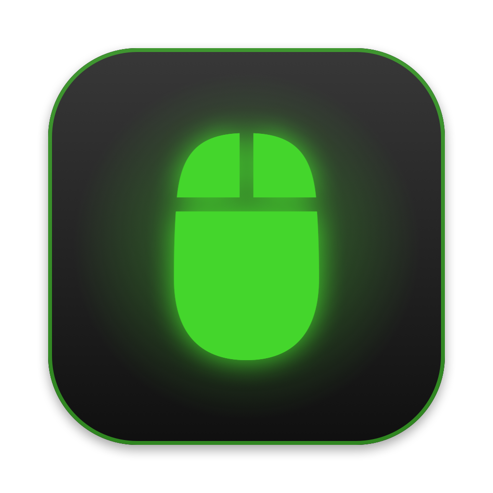

# Razer Mamba för macOS

Styr belysningen på en **Razer Mamba (2015 Chroma)** native på Apple Silicon – utan Razer Synapse, utan Rosetta och utan kernel-drivrutin.



Projektet består av två delar:

- **`razerctl`** – ett litet kommandoradsverktyg i C som skickar Razers belysningskommandon till musen.
- **RazerToggle** – en menyradsapp i Swift. Vänsterklick slår av/på belysningen, högerklick öppnar en meny med färger, effekter och ljusstyrka.

## Stödda enheter

| Mus | USB-ID |
|---|---|
| Razer Mamba 2015 Chroma, trådbunden | `1532:0044` |
| Razer Mamba 2015 Chroma, trådlös (dockan) | `1532:0045` (otestad) |

Andra Razer-möss använder samma protokoll men ofta ett annat transaction-ID. De kan läggas till i `MAMBA_PIDS` i [razerctl.c](razerctl.c), men är inte testade.

## Installation

Kräver Xcodes kommandoradsverktyg (`xcode-select --install`).

```bash
# 1. Bygg och installera razerctl
clang -O2 -Wno-deprecated-declarations -o razerctl razerctl.c -framework IOKit -framework CoreFoundation
cp razerctl /usr/local/bin/

# 2. Bygg och installera menyradsappen i /Applications
./RazerToggle/build.sh

# 3. (valfritt) Starta appen automatiskt vid inloggning
cp RazerToggle/se.pija.razertoggle.plist ~/Library/LaunchAgents/
launchctl bootstrap gui/$(id -u) ~/Library/LaunchAgents/se.pija.razertoggle.plist
```

Ta bort autostarten:

```bash
launchctl bootout gui/$(id -u)/se.pija.razertoggle
rm ~/Library/LaunchAgents/se.pija.razertoggle.plist
```

## Användning

```text
razerctl off                 Släck all belysning
razerctl on                  Tänd (regnbåge, full ljusstyrka)
razerctl spectrum            Regnbågscykel
razerctl static R G B        Fast färg, t.ex. static 0 255 0
razerctl wave [left|right]   Färgvåg
razerctl breathing [R G B]   Andning i en färg (utan färg: slumpade)
razerctl reactive R G B      Lyser upp när du klickar
razerctl brightness 0-255    Ljusstyrka
```

Sätt `RAZER_DEBUG=1` för att se vad som skickas. Menyradsappen loggar till `~/Library/Logs/RazerToggle.log`.

## Hur det fungerar

Razer-möss tar emot belysningskommandon som en 90 byte lång *HID feature report*: kommandoklass, kommando-ID, argument och en XOR-checksumma. Protokollet är dokumenterat av [OpenRazer](https://github.com/openrazer/openrazer).

`razerctl` skickar rapporten som en USB `SET_REPORT`-kontrollöverföring direkt till enheten. Det går förbi macOS HID-lager, som annars kräver behörigheten *Inmatningsövervakning*, och därför fungerar verktyget även när det startas från menyradsappen. Om USB-vägen misslyckas provas HID-vägen som reserv.

## Licens

[MIT](LICENSE). Projektet har ingen koppling till Razer Inc. "Razer" och "Mamba" är varumärken som tillhör Razer Inc.
